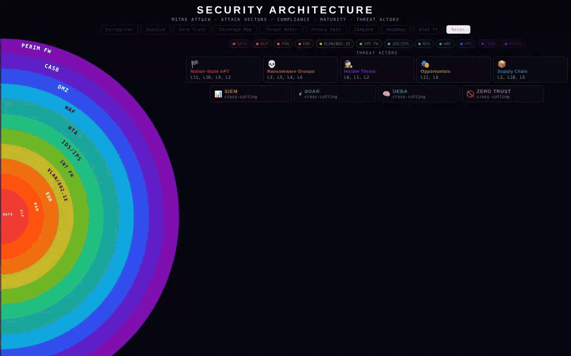
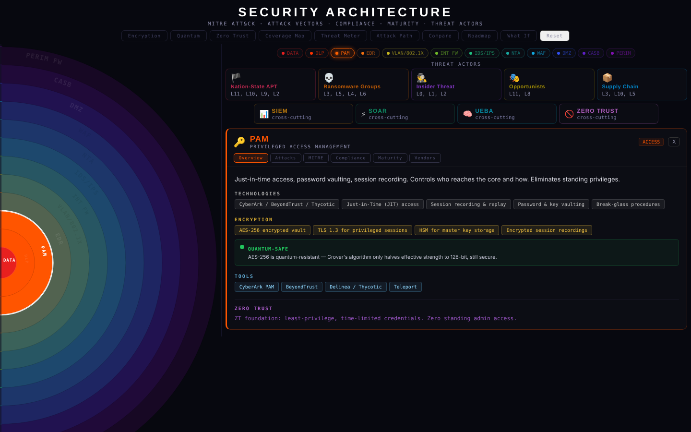
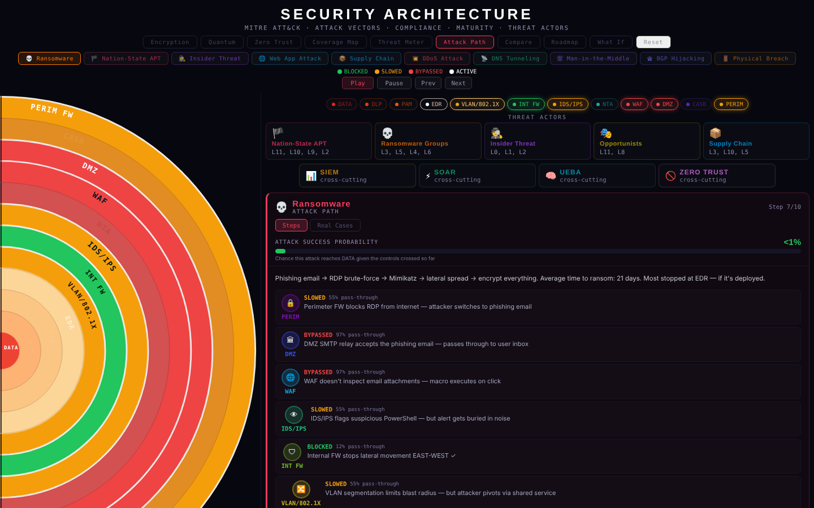
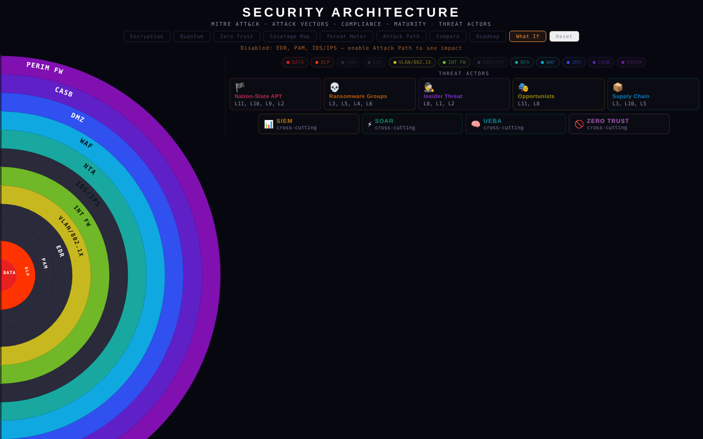
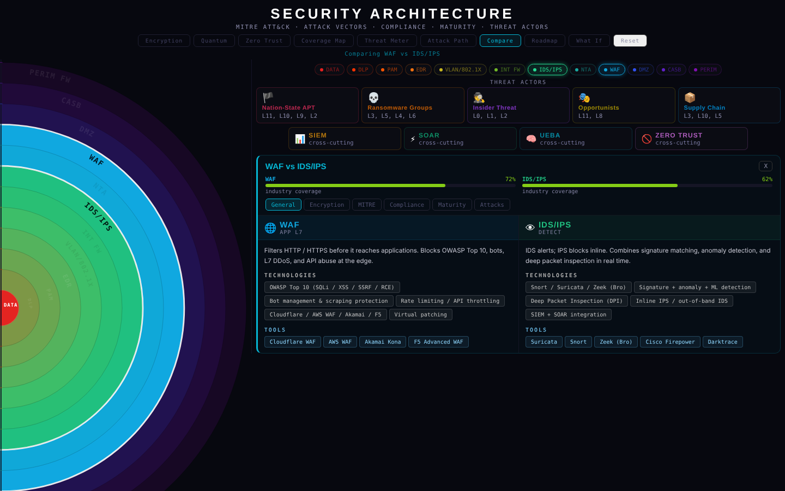

# Security Architecture Onion

An interactive defense-in-depth model. Twelve security control layers are drawn as concentric rings around the data they protect. You can follow an attack ring by ring, see which controls block, slow or miss it, and check how each layer maps to MITRE ATT&CK and compliance frameworks.

**[▶ Live demo](https://IreneN-V.github.io/security-architecture-onion/)**



## Why I built it

I made this while studying for CompTIA Security+ (SY0-701), which I passed. Lists of controls didn't show me how they work together. I wanted to see why a single control is never enough, and which layer actually stops a given attack.

## The 12 layers (inside → out)

| # | Layer | Role |
|---|-------|------|
| 0 | **Data** | Critical assets: databases, secrets, PII, IP |
| 1 | **DLP** | Data Loss Prevention |
| 2 | **PAM** | Privileged Access Management |
| 3 | **EDR** | Endpoint Detection & Response |
| 4 | **VLAN / 802.1X** | Segmentation, PEAP, NAC |
| 5 | **Internal FW** | East-west traffic control |
| 6 | **IDS / IPS** | Intrusion detection & prevention |
| 7 | **NTA** | Network traffic analysis |
| 8 | **WAF** | Web application firewall |
| 9 | **DMZ** | Demilitarized zone |
| 10 | **CASB** | Cloud access security broker |
| 11 | **Perimeter FW** | North-south traffic control |

The cross-cutting capabilities **SIEM, SOAR, UEBA** and **Zero Trust** are shown separately, because they span every layer.

## Features

**Per-layer detail.** Click any ring to open six tabs:
- **Overview:** technologies, encryption used at that layer, example tools, Zero Trust role
- **Attacks:** the threats this layer is meant to stop
- **MITRE:** mapped ATT&CK techniques (46 technique IDs across the model)
- **Compliance:** relevant controls from PCI DSS, ISO 27001, SOC 2, NIST CSF, GDPR, HIPAA
- **Maturity:** a 5-level CMMI-style scale (Initial → Optimizing)
- **Vendors:** example products for the layer compared on a radar chart

**Attack Path.** Ten scenarios (ransomware, nation-state APT, insider threat, web app attack, supply chain, DDoS, DNS tunneling, MITM, BGP hijacking, physical breach) play out step by step. Each layer is marked *blocked*, *slowed* or *bypassed*, and an attack-success probability meter updates as the attack moves. A *Real Cases* tab ties scenarios to incidents such as Colonial Pipeline, SolarWinds (SUNBURST), Capital One, Equifax and Target.

**What If.** Switch off any layers and replay an attack to see how much more often it gets through.

**Compare.** View two layers side by side: technologies, encryption, MITRE coverage, compliance, maturity and attacks.

**Roadmap.** Mark the controls you already have and get a phased, prioritized plan for the rest, with cost, complexity and risk-reduction estimates.

**Overlays:**
- *Encryption:* which protocols apply at each layer (TLS/mTLS, AES-256, IPsec, FDE, 802.1X)
- *Quantum:* which layers rely on quantum-vulnerable asymmetric crypto and which are already quantum-resistant (with notes on NIST PQC: ML-KEM, ML-DSA)
- *Zero Trust:* how each layer contributes to a ZT architecture (NIST SP 800-207)
- *Coverage Map:* a heatmap of how widely each control is deployed across the industry
- *Threat Meter:* animated attack streams showing how deep each one reaches

## Screenshots

| Layer detail | Attack path |
|---|---|
|  |  |
| **What If: EDR, PAM and IDS/IPS disabled** | **Compare: WAF vs IDS/IPS** |
|  |  |

## Tech

- React 18, built with Vite
- All diagrams are hand-built SVG: ring geometry, arc labels, radar charts and animations are computed in code, with no charting library
- Deployed to GitHub Pages through GitHub Actions

## Run locally

```bash
git clone https://github.com/IreneN-V/security-architecture-onion.git
cd security-architecture-onion
npm install
npm run dev
```

Production build: `npm run build` (output goes to `dist/`).

## Disclaimer

This is an educational model. Coverage percentages, pass-through rates and attack-success probabilities are illustrative estimates for learning, not measured data. Vendor names are given as examples, not endorsements.
